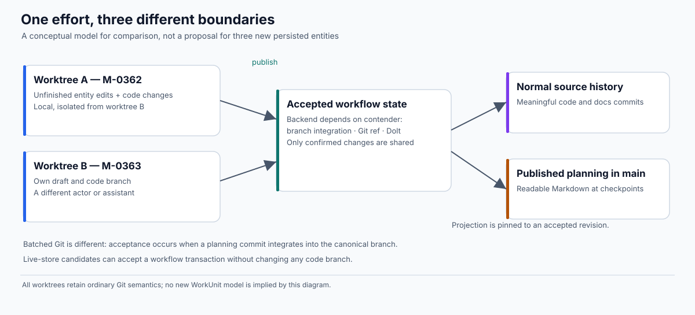
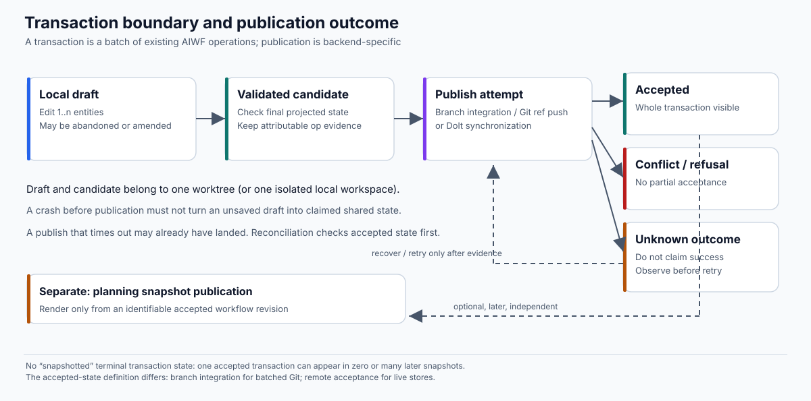
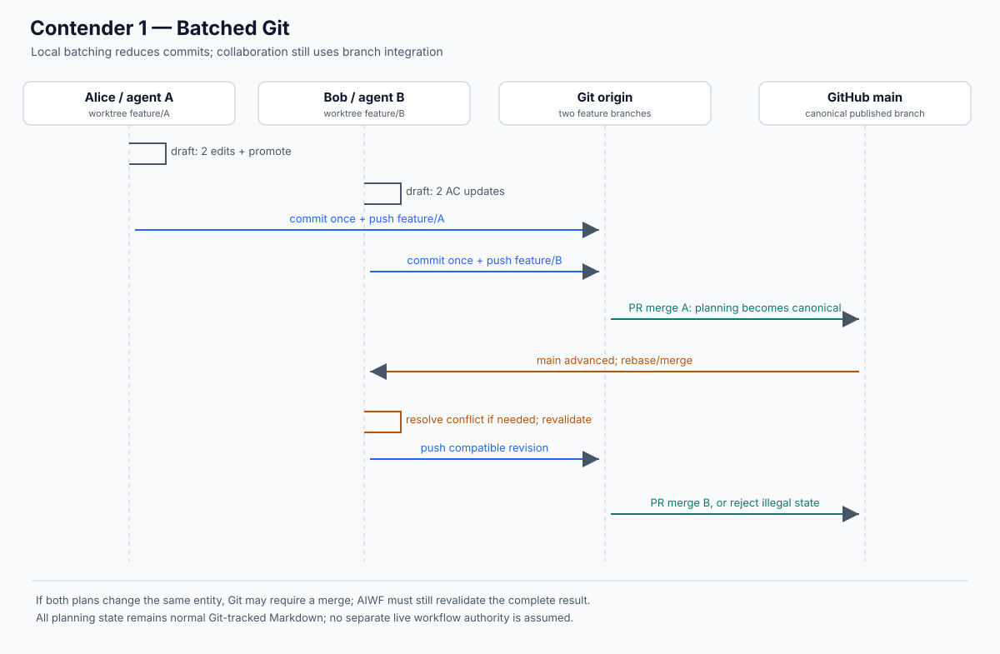
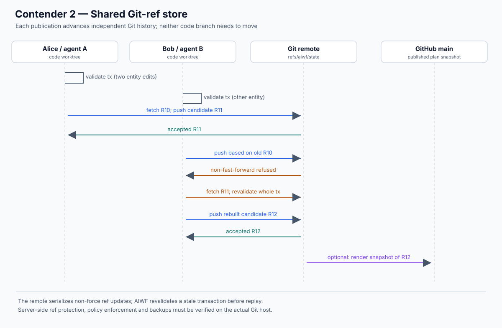
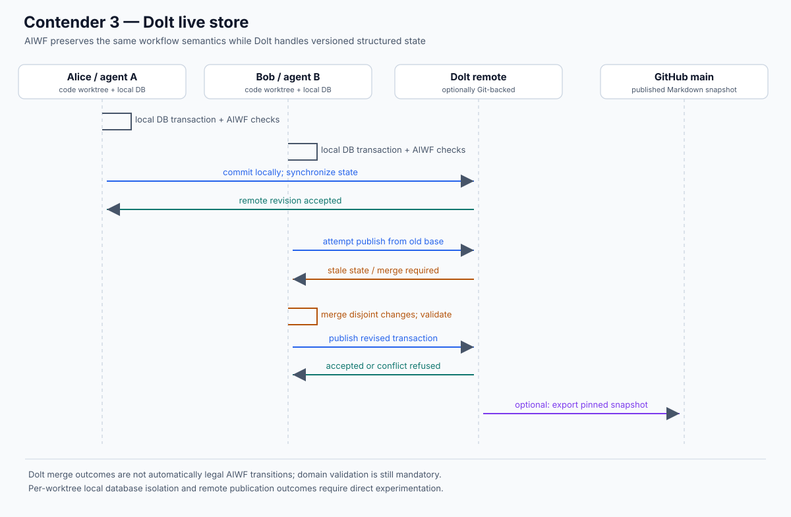
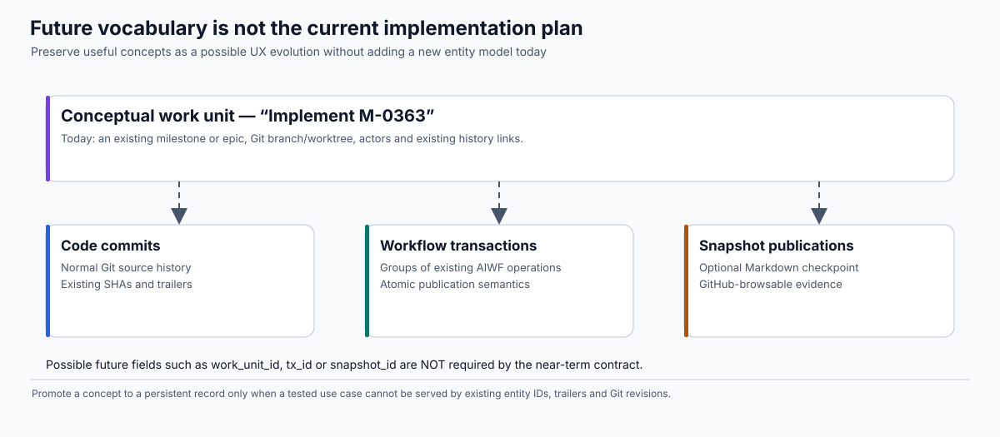

# Collaborative state and commit granularity: a research specification

> **Status:** exploratory; unratified; **not** an ADR, implementation request, or change to the AIWF kernel contract  
> **Date:** 2026-10-24  
> **Question:** What is the smallest evolvable change that lets multiple humans and AI agents collaborate using Git worktrees, materially reduces routine AIWF commits in ordinary development history, and keeps useful planning visible to GitHub-only readers?  
> **Working hypothesis:** Batch AIWF operations into meaningful atomic units; distinguish *accepted working state* from intentionally *published planning*; choose a storage backend only after comparison against a human-owned executable oracle.  
> **Tags:** #research #aiwf #collaboration #git #worktrees #transactions #verification #kiss #yagni

## Abstract

AIWF currently uses Markdown in ordinary Git branches as canonical workflow state, Git commit history for provenance, and one commit per mutating verb. Those were deliberate, successful choices, but the result can obscure meaningful code history with small edits, status transitions, acceptance-criterion updates, and generated documents. Conventional branching also requires manual coordination when several people or assistants change planning simultaneously.

We compare **three contenders**, not three new product designs: (1) existing branch-canonical Markdown with batched operations; (2) a shared independent Git-ref store with occasional GitHub-browsable Markdown snapshots; (3) a Dolt-backed live store with the same snapshot discipline. All must support ordinary Git worktrees for code and agent isolation. The research preserves AIWF's existing entity vocabulary and verbs initially. A richer *work unit → workflow transaction → snapshot publication* vocabulary, discussed earlier, is retained as an **explicit future-design appendix**, not silently promoted to new persistent objects.

The proposed order is **behavioral contract → ratified oracle(s) → bounded simulation → concrete integration experiments → architectural decision**. A bounded simulation can disprove a protocol and establish evidence within stated limits; it cannot prove an arbitrary future AIWF implementation correct or establish a Git host's actual guarantees.

## 1. Problem and evidence

### 1.1 Goals, in priority order

1. **Cooperate across people and agents.** Independent worktrees and different machines can work on plans safely. Confirmed changes cannot vanish or be silently overwritten. Conflicts are attributable and understandable.
2. **Clean normal Git history.** Ordinary code branches primarily communicate meaningful code, documentation, and deliberately published planning—not each intermediate AIWF bookkeeping change. Fewer total Git objects is a separate, secondary metric.
3. **Browse without installing AIWF.** A GitHub visitor can understand the latest **published** plan directly as Markdown on the default branch. It is acceptable, by explicit product decision, for this to lag current live planning; the snapshot must say what revision it represents.
4. **Keep worktrees and ordinary editing.** An agent can continue to use a feature worktree and inspect readable Markdown. Experimental synchronization must not rewrite its `HEAD`, index, staged files, or unpublished local edits unexpectedly.
5. **Keep AIWF small and migratable.** No service, database, extra entity kind, generic adapter framework, or permanent schema is presumed necessary. The human ratifies any kernel-level departure after evidence.

### 1.2 Commit sample: evidence for the size of the problem

An exploratory classification of **a prior 200-commit sample of `main`**, anchored at [`736018f9`](https://github.com/23min/aiwf/commit/736018f9bcdf5065a9db9cab5d53664c996ed6b6) and spanning commits dated **2026-10-12 through 2026-10-21**, found (newer AIWF commits now exist):

| Type identified from commit message/trailers, with representative patch checks | Count |
|---|---:|
| Entity-body edits | 60 |
| Entity creation / acceptance-criterion additions | 16 |
| Lifecycle promotions | 30 |
| Entity retitles | 7 |
| Entity archiving | 3 |
| Separately committed generated roadmap updates | 8 |
| Code/docs/release and other changes | 62 |
| Merge commits | 14 |
| **Total** | **200** |

The first six categories sum to **124/200 (62%)**, a *potential upper-bound-like opportunity* for a broad workflow-state separation, **not** an exact predicted saving: some substantive entity writing may deserve publication on `main`, mixed file changes need individual treatment, and batching could yield intermediate savings. Moving strictly provenance-only empty operations would remove **zero clearly identifiable commits in this sample**. Moving lifecycle promotions and generated roadmap commits would target **38/200 (19%)**, *only if those fields and projections are no longer independently tracked in the ordinary branch*.

We must measure the **same representative workload** under the three contenders, including actual merge topology, rather than extrapolate this sample to all projects. Keep separate metrics for commits reachable from `refs/heads/*`, Git objects in all refs, human-resolution incidents, and public GitHub readability.

### 1.3 Constraints carried forward from AIWF

The current [design decisions](../design/design-decisions.md), [CLAUDE.md](../../CLAUDE.md), and [research kernel](KERNEL.md) establish important commitments:

- Markdown/frontmatter as human-readable state, existing six entity kinds and established legal transitions, stable entity IDs, relationships and content checks.
- `aiwf history` based on Git history/trailers; provenance must be honest and attributable.
- `aiwf check` and pre-push enforcement as trustworthy chokepoints, not AI-instruction-only guidance.
- `aiwf worktree add` already sets up dedicated Git worktrees and host-specific ignored artifacts.
- Mutating verbs produce `verb.Plan` and use a carefully isolated Git commit seam. This seam assumes `HEAD` today, so repointing it is a kernel change.
- Existing batching precedents: multi-AC `add ac`; single-commit `import`. General batching is not established and must not destroy per-operation history.
- Accepted [D-0037](../../work/decisions/D-0037-defer-adr-0001-g-0281-and-emb-pending-a-measured-id-collision-trigger.md) defers a narrower ID-collision/inbox approach because measured collision friction was small. This research concerns multi-user current state *and* commit readability; it does not quietly reopen that decision.
- Accepted [D-0054](../../work/decisions/D-0054-keep-the-reasoning-derive-the-facts-record-obligations-not-events.md) recommends retaining reasoning and obligations while deriving facts; the design must not add a new ledger merely because it can.

**Any departure from an accepted kernel guarantee is a decision**, not an incidental refactor. The question is whether the user-facing guarantee can be retained with a smaller different implementation.

## 2. Minimal shared vocabulary—not new domain objects

| Term for research | Meaning | What we do **not** assume |
|---|---|---|
| **Existing AIWF entity** | An epic, milestone, AC, gap, decision, ADR or contract as modeled today. | No new entity kind. |
| **Work context** | Existing branch/worktree, actor, active milestone or epic, and existing scope. | No permanent `WorkUnit` record or ID. |
| **Operation** | An existing verb's intended validated mutation (including a no-op/refusal result). | Not necessarily a new event-log entry. |
| **Transaction** | One atomic, ordered set of operations whose combined final state is validated before acceptance. | Not necessarily a stored database entity, CLI session or independent schema. |
| **Local draft** | Unaccepted work owned by a particular worktree/client. | Not public/shared just because it exists on disk or as a local Git commit. |
| **Acceptance / publication** | The backend's authoritative successful acceptance of an entire transaction. | Not always equivalent to `git push`: batched Git usually accepts at mainline integration. |
| **Published snapshot** | Human-readable Markdown view rendered from one identified accepted revision and committed through normal Git review. | Not a second writable authority; not part of the transaction lifecycle. |

**Important correction to earlier brainstorming:** `snapshotted` is **not** a terminal transaction state. An accepted transaction might be reflected in no snapshots yet, one snapshot, or many subsequent snapshots. A snapshot is an independent projection/publication action.



## 3. Candidate transaction contract

We need transaction *semantics* before a `tx begin` command. A first implementation could expose an implicit transaction when running an existing verb, and later offer batching through existing `Plan` composition or a small explicit boundary.

### 3.1 Scope and atomicity

A proposed transaction:

- Contains one or more **ordered existing entity operations**; it can touch multiple entities but is accepted or rejected **as a whole**.
- Runs existing entity, relation, transition, content and authorization checks on the **combined projected result**, not just on each intermediate operation in isolation. Where order is meaningful, each proposed intermediate transition must also be legal.
- Retains enough evidence to distinguish constituent operations and their affected entities, even if a backend stores the batch as one Git commit or database commit.
- Never includes arbitrary code modifications as an atomic member. Normal code Git commits remain separate and can be associated through existing entity IDs/trailers as far as possible.
- May be abandoned or revised while local. Once *accepted*, an operation cannot be silently substituted with a different intent under the same stable identity.
- Makes no promise of an atomic commit involving both code-branch history and independently published workflow state; two Git refs (or Git and Dolt) cannot be assumed to share a transaction.

**First-slice simplification:** restrict a transaction to a single actor and compatible authorization context. Support editing existing entities and ACs first; do not expand to mixed-actor batches, automatic reallocation or arbitrary file operations until the oracle makes those cases precise.

### 3.2 Minimal durability and states

A research model may represent `draft → candidate → publication attempt → accepted | rejected | uncertain`, with recovery/revalidation. These are **model states**. They do not mandate new product-wide status enums, folders, persisted YAML fields or user-facing commands.

- **Draft:** changing local content; not remotely accepted.
- **Candidate:** a complete intended batch is recorded sufficiently to recover from a client crash before remote effects are attempted.
- **Attempt:** acceptance may be concurrent with other writers.
- **Accepted:** authoritative backend has provided evidence of acceptance of the entire batch.
- **Rejected/conflicted:** no partial effect; keep local intent available for an explicit revision.
- **Uncertain:** a response was lost or publication outcome unknown; do not falsely claim success or reissue a distinct operation. Observe the backend before retrying.

Not every backend exposes these phases as distinct APIs. In batched Git, a local commit is *not* acceptance into `main` and a pushed feature branch isn't automatically canonical. In a live store, acceptance is the authoritative remote revision containing the transaction.



### 3.3 Provenance without inventing a ledger

AIWF currently obtains provenance from ordinary Git commit trailers, often treating a single commit as one verb on one entity. A multi-operation commit breaks that convenient mapping. The research must answer whether an existing commit message, an extension to trailers, a deterministic per-batch manifest, or backend-native history is the **smallest sufficient evidence**.

Required outcome: for each accepted logical operation, `aiwf history` and the standing provenance checks can reconstruct what changed, what entity was affected, who acted, under whose authority, and in which order where ordering matters. They must not mistake a single `aiwf-verb:` trailer for all operations inside a batch. Do **not** commit to fields like `tx_id` or `work_unit_id` simply because such a representation would be convenient.

A useful counterexample for the oracle: a commit's final tree contains two legal-looking status changes but the provenance only attests to one. A checker must not accept this as faithfully attributable merely because the final Markdown parses.

### 3.4 Existing IDs and scope

Namespaced AC IDs and existing entity IDs remain the user-facing references. We need to model collisions and cross-transaction references, but this does not automatically require temporary public IDs or a new global allocator. Evaluate whether batching and current collision recovery suffice for contender 1, and whether publication-time allocation is necessary for live stores.

Authority-sensitive operations need their authorization checked at a specified boundary, including the case where an authorization is revoked while a transaction is pending. A historical code commit's meaning must not silently change when live workflow state advances. **When** authority is required—at operation creation, workflow acceptance, code push, PR merge—is a **policy question for explicit ratification**, not a hidden engineering decision.

### 3.5 Snapshot contract

A published planning snapshot is a generated Git change from **one identifiable accepted state**. It includes enough visible metadata to say which accepted revision was rendered and makes its potentially stale nature honest. Changes should be reviewed/merged like project documentation; a GitHub reader without AIWF can browse the latest published plan.

**One canonical owner per mutable field.** If `work/` is authoritative in a live store, the GitHub snapshot files cannot also be independently edited as authority. If `work/` stays canonical in `main` (batched Git), the snapshot is usually simply the integrated tree and no second export system is needed.

Current `work/` paths, `docs/adr/`, Markdown links, editor behavior, and agent workflows make this a real migration question. Do **not** prematurely decide between `planning/` tracked + `work/` ignored, tracked `work/` snapshot + separate `.aiwf/` live view, or a different layout. Ordinary Git ignore rules cannot turn tracked and ignored copies of the *same path* into two independent histories.

## 4. Worktree requirements (common to all contenders)

A development **Git worktree remains the primary code/AI agent workspace**. Each worktree has its own checked-out branch, index, local drafts and agent context, but linked worktrees share their Git object store and most refs. That shared ref behavior is relevant to isolation tests.

**WT-1 — draft isolation.** A draft mutation in worktree A cannot change, discard or silently commit a draft in worktree B.

**WT-2 — source isolation.** Publishing workflow state never silently advances or edits another worktree's code `HEAD`, live index or worktree files. For contender 1, the planned ordinary branch commit is explicitly in the initiating worktree only.

**WT-3 — recovery.** Any local intent represented as safely finalized must survive a crash. Deleting/cleaning a worktree must not silently erase a claimed durable pending transaction.

**WT-4 — cross-machine clarity.** A transaction accepted by another machine may require refreshing a local view; `aiwf show` must not silently present stale data as latest accepted state.

**WT-5 — no invisible edits.** Locally modified materialized Markdown cannot be overwritten by fetch, merge or export without a detected conflict or an explicit discard.

**WT-6 — no broad host assumptions.** Custom ref push/protection, ordinary Git branch protection, Dolt publication, backups and remote validation must be checked on the intended approved host—not inferred from a temporary local bare repo.

For initial research, use `aiwf worktree add` for the **research checkout**. Use independent disposable clones with a local bare remote for destructive/concurrent Git experiments. Do not test shared-ref rewrites in the main AIWF repository: worktrees share that ref namespace.

## 5. Three contenders, using the same questions

### 5.1 Contender 1: batched Git, existing canonical files

Canonical planning files stay in ordinary Git branches. Several existing verbs' effects become one reviewed, accurately attributed planning commit. Branch merges or PR integration determine when changes become canonical on `main`. `ROADMAP.md` can be rendered alongside a coherent batch instead of regenerated after every minor action.

**Cheapest adaptation path:** build a composed projection from existing verb operations and use the already-isolated commit machinery; do not create a generic storage backend interface. Current `add ac` and `import` batching are precedents, but their contracts do not automatically prove a general-purpose transaction safe.

**Deliberate limitation:** feature branches are not a single shared live planning store. Two agents can publish branches independently and still need merge/rebase and sometimes human resolution. A pushed feature branch is discoverable, but is not universally current canonical planning state.



### 5.2 Contender 2: Git live store and published snapshots

One independent ref, candidate `refs/aiwf/state`, contains canonical workflow Markdown and provenance. It never merges into ordinary development history. A cooperating publisher fetches accepted state, revalidates the complete transaction, constructs a candidate with that accepted tip as parent, then non-force pushes. On non-fast-forward, retry only after semantic revalidation. On uncertain acknowledgment, check whether the *same intended operation* has already landed before publishing again. Snapshot export to ordinary `main` occurs deliberately.

**Reuse first:** existing Markdown formats, check rules, trailer understanding, and Git plumbing. The current `CommitTree` is `HEAD`-specific, so changing the target needs new explicit-ref tests, not a silent reuse.

**Decisive risks:** a remote may allow a semantically invalid fast-forward, a privileged actor may rewrite/delete a custom ref, the host may not allow the namespace or protect it, and two ref updates are not an atomic code+workflow transaction. AIWF client checks alone cannot promise server-enforced append-only history.



### 5.3 Contender 3: Dolt live store and published snapshots

Store current workflow state in Dolt and map entity CRUD into DB updates. Each worktree needs a deliberately isolated local DB/working-set strategy (not assumed to be the same as `git worktree`). Dolt handles structured versioned state and merges; AIWF still judges entity transitions, provenance, permissions and cross-entity invariants. A snapshot renderer exports accepted state into GitHub-readable Markdown at selected checkpoints.

**Potential advantage:** concurrent edits to different rows/fields may be easier to merge than whole-file Markdown changes. **Real cost:** a Dolt dependency, schema/projection migration, and an additional set of synchronization and retention semantics. A database-level merge is not proof of AIWF policy legality.

Do not assume Git-backed Dolt's underlying refs preserve an immutable AIWF audit log without explicitly checking Dolt's version-history and retention guarantees. No new remotely deployed database service is assumed, but the approved Git hosting environment and chosen Dolt distribution still require a capability test.



### 5.4 Comparison dimensions

| Evaluation dimension | Batched Git | Git live store | Dolt live store |
|---|---|---|---|
| Canonical shared state | `main` after integration | Accepted independent Git ref | Accepted Dolt state |
| Worktree draft isolation | Existing Git worktrees, plus batch drafting | Explicit worktree-owned drafts + shared ref | Explicit worktree-owned drafts + local DB isolation |
| Publish boundary | Merge/PR into canonical branch | Non-force ref update | Dolt remote accepted revision |
| GitHub-readable plan | Ordinary tracked Markdown | Explicit Markdown snapshot | Explicit Markdown snapshot |
| Commit noise | Reduced by batching, still in `refs/heads/*` | Routine operations out of code history | Routine operations out of code history |
| Hardest risk | Branch merge friction + provenance of batch | Semantic retry, ref integrity, remote enforcement | Schema/merge semantics, dependency and governance |
| Primary value of experiment | Is batching alone enough? | Is our Git protocol small enough? | Does structured merge justify Dolt? |

A comparison must **not** erase different semantics merely to use a uniform interface. A common *oracle* is shared where requirements genuinely are the same; each implementation model documents its own acceptance, isolation and consistency promises.

## 6. Model before implementing: verifier-kit oracles

### 6.1 Existing starting point

[verifier-kit's `examples/ref_sync`](https://github.com/23min/verifier-kit/tree/main/examples/ref_sync) already has a ratified single-operation spine, a deterministic two-client explorer, loss/crash/retry scenarios, real-Git assumptions tests and mutation probes. Its `spine` and `verify` toolchain is moving to Go and command-based language-agnostic runners; the **current ref_sync example's concurrent explorer remains Python and example-specific**. It models **one intent per client**. It is evidence of feasibility, not already an oracle for AIWF's batched workflow, authorization, snapshots or Dolt.

Do **not** add a general-purpose explorer/DSL solely for this investigation. First extend a small independently owned bounded model, running from verifier-kit's existing command-based verification entry point. If more examples need exploration, extract a generic engine under an owner-approved tool-contract change. An AIWF-specific Go model can be used without making Python part of AIWF's production dependencies.

### 6.2 Two levels of oracle

1. **Human-ratified common oracle.** Defines legal effects, refusal conditions, preservation of attribution, worktree safety and honest published snapshots, independent of whether Git or Dolt implements them.
2. **Contender-specific refinement models.** Define each backend's state and permitted steps: branch divergence/merge for contender 1; ref update/retry for contender 2; versioned DB transaction/merge for contender 3. The model should admit honest *impossibility or limitations*, not invent a shared consistency property that one contender cannot provide.

Only after these are reviewed should implementation adapters be compared against executable behavior. The proposer of an implementation should not be allowed to quietly revise its oracle just to make tests pass. Include mutation probes which delete an authorization check, replay an uncertain transaction twice, drop an operation from a batch, or publish a snapshot of a nonexistent revision.

### 6.3 Candidate safety invariants — for ratification, not yet accepted

| ID | Proposed requirement | Example counterexample |
|---|---|---|
| S1 | **Batch atomicity:** no accepted prefix of a refused batch. | The first AC is published but the second fails. |
| S2 | **No lost acceptance:** later authoritative state retains accepted work or records explicitly permitted supersession. | Bob overwrites Alice's confirmed entity. |
| S3 | **Attributable operations:** all accepted constituent operations are recoverable with actor, entity and required authority. | Batch final tree changes two entities but attests to one. |
| S4 | **No false confirmation:** uncertain or local-only changes are not reported as shared accepted. | Push reply lost; client asserts success without evidence. |
| S5 | **Idempotent recovery:** retry after unknown outcome does not apply the same logical effect twice. | A timed-out promotion is repeated as a second event. |
| S6 | **No silent semantic conflict:** concurrent incompatible edits do not last-writer-win. | Both edit same milestone body; one silently disappears. |
| S7 | **Legal entity transitions:** existing FSM and cross-entity invariants apply to the final accepted state and required intermediate steps. | Batch bypasses a forbidden `done → draft` step. |
| S8 | **Worktree isolation:** one worktree's draft and index survive the other's write/sync. | Agent B refresh overwrites A's uncommitted prose. |
| S9 | **Canonical ownership:** no mutable field is independently authoritative in live store and `main` snapshot. | GitHub snapshot edit silently overrides accepted live state. |
| S10 | **Snapshot fidelity:** published Markdown identifies and accurately reflects one accepted revision; a subsequent snapshot never silently regresses the published baseline. | Render mixes state from two revisions. |
| S11 | **Stable identity:** IDs do not alias different entities; rename/reallocation stays explainable. | Two accepted concurrent allocations claim the same ID. |
| S12 | **Defined authorization timing:** no accepted write bypasses the selected actor/principal/scope rule. | Scope revoked; stale transaction still accepted. |

**S2 requires an explicit definition of supersession and eventual archival; S12 cannot be checked until the authority boundary is chosen.** Liveness is conditional: if publication eventually becomes available and contention is bounded, does a still-legal transaction eventually complete or return an actionable refusal? Do not claim unconditional progress under disconnection.

### 6.4 Bounded scenarios and search dimensions

Start with two clients, two existing entities, up to two operations per transaction, one failure. Enumerate legal orders instead of using nondeterministic threads. Keep durable and volatile client state separate.

| Scenario | Behavior to exercise | Particularly distinguishes |
|---|---|---|
| C1 | One worktree, two edits + promotion, one accepted batch | All three; provenance cardinality |
| C2 | Alice and Bob change different entities concurrently | Branch merge vs ref replay vs Dolt merge |
| C3 | Same entity/same field updated concurrently | All three; no silent overwrite |
| C4 | First op valid, second invalid; whole batch rejected | All three; atomicity |
| C5 | Client crashes after local preparation but before publication | Draft durability and recovery |
| C6 | Publication accepted but reply lost; retry observes original effect | Git ref and Dolt; adapted to Git merge response |
| C7 | Shared state advances and pending authorization becomes invalid | All three; authority timing |
| C8 | Concurrent ID allocation or AC numbering | All three; collision semantics |
| C9 | Alice edits uncommitted Markdown while Bob synchronizes | Worktree + materialization isolation |
| C10 | Snapshot generation races with new live state | Live-store candidates; pinned revision |
| C11 | Two publications of the same transaction identity | Idempotence / retry |
| C12 | Host refuses custom refs, accepts force rewrite, or fails remote check | Git ref deployment capability (real-host test) |
| C13 | Code commit exists, workflow publication fails, or vice versa | Cross-history non-atomicity |

Search state-space reports must distinguish **violation**, **passed all reachable states within a complete configured finite bound**, **truncated by state/depth limits**, and **model/harness error**. Produce a minimal counterexample trace with worktree, actor, action, state revision and why the invariant failed. Test checker sensitivity with deliberately broken variants. A model whose state key omits relevant history, such as accepted operation IDs, can suppress violations; the deduplication representation is part of the oracle review.

### 6.5 Verification is not the whole experiment

Verification explores assumptions; real integration tests must check those assumptions. At minimum:

- Two real isolated Git clones and a disposable bare remote for ref atomicity, fast-forward behavior, isolation of `main`, and fetch/recovery.
- Real AIWF `Plan`/`Apply` behavior under multi-operation batches, including history/CI checks.
- Host support for custom refs, branch protection and enforcement on the **approved hosting service**; a local bare remote does not settle it.
- Actual Dolt behavior for independent local state, conflicts, merges, transport failure, history retention, and repeatable Markdown export.

Record what each test **does not** establish; avoid calling a bounded pass a proof of unbounded correctness.

## 7. Decision sequence and experiment gates

**Stage R0 — Research approval.** Human reviews this document, deletes weak requirements, ratifies a small common-oracle chapter and accepts the open assumptions. No production AIWF CLI changes.

**Stage R1 — Local batching oracle.** Model C1/C4 and operation attribution. Test with a tiny prototype composed from existing AIWF verbs/Plans, keeping worktree behavior unchanged. If batching gives sufficient history reduction and collaborative ergonomics, contender 1 can win without a live store.

**Stage R2 — Concurrency refinements.** Model C2/C3/C5/C6/C7/C8/C11 for Git-ref and Dolt contenders, with deliberately bounded fault counts. Existing verifier-kit `ref_sync` provides starting ideas but not ready-made AIWF verification.

**Stage R3 — Worktrees and snapshots.** Model C9/C10/C13, document which paths are current vs projected and what GitHub-only readers see. Probe render latency and GitHub links. Do not select a directory migration until users can inspect the change.

**Stage R4 — Real backends.** Small disposable Go/Git and Dolt exercises against the *same ratified scenarios*. Use actual repository commands and the prospective approved remote for deployment-specific claims.

**Stage R5 — Decision, not platform build-out.** Compare source-branch commit count, change discoverability, GitHub plan age, conflicts requiring human intervention, time to share, recovery behavior, operational burden and migration footprint. Ratify one ADR only when the measured benefits justify changing AIWF's existing kernel commitments.

A non-goal is to implement and permanently maintain all three backends. Their experiments are competing hypotheses.

## 8. Open decisions — do not pre-answer in code

- **Transaction boundary:** can existing `Plan` composition provide atomic batching without an explicit long-lived `tx begin/commit/publish` UX?
- **Audit:** can one Git commit faithfully attest to several operations using a small trailer extension, or is a separate per-batch manifest genuinely necessary?
- **Current-state reading:** when a remote is unavailable, may AIWF serve explicitly stale state for reading, and what fails closed for writing?
- **Authority:** must agent authorization be valid at operation preparation, workflow publication, code push, merge, or a declared combination?
- **Entity paths:** how do `work/`, `docs/adr/`, internal path links and AI cold-reading behave when some paths are snapshots rather than live authority?
- **Snapshot cadence:** PR merge, milestone/epic completion, explicit manual publication, or multiple options? Avoid a daemon by default.
- **Collaboration requirements:** is branch/PR visibility enough for most teams, or is low-latency shared workflow state a hard need?
- **Deployment:** can the approved Git host protect and validate a custom ref without new infrastructure? What assurance is required?
- **Dolt:** does structured merging reduce semantic conflicts enough to compensate for the dependency and schema migration?
- **Scope:** which entity kinds and operations must be in the first prototype? Limit it to the minimum that can falsify each hypothesis.

## 9. Complexity budget and reversibility

- **Zero new required domain entity kinds** in the first experiment.
- **Zero required long-running background services.** No local daemon or central server introduced as a prerequisite.
- **No generic storage interface** until at least two implementations demonstrate stable, truly shared behavior requiring one.
- **No unconditional remote publication** on every existing verb just to preserve existing UX. Operation count and commit count are separate.
- **No automatic CRDT/general Markdown merge.** Compatible operations may be replayed after domain revalidation; incompatible edits require attention.
- **No dual mutable authority.** Snapshots are explicitly derived in a live-store option; tracked Markdown remains canonical in batched Git.
- **Migration should be opt-in and separately ratified.** Legacy repositories remain usable throughout experiments; historical Git provenance remains queryable or explicitly mapped without falsification.
- **Operational data and recovery state stay local and reviewable.** No invented universal IDs or fields unless the oracle shows existing Git SHA, entity IDs, and scope context are insufficient.

## Appendix A — Retaining the richer design vocabulary for a possible future

> **Non-normative design horizon.** This appendix deliberately captures ideas from earlier discussion so they are not discarded by KISS/YAGNI. Nothing here is a requirement, schema, command, storage format or agreed roadmap item.

### A.1 Why the vocabulary was attractive

The terms **work unit**, **workflow transaction**, and **snapshot publication** express three different temporal/semantic boundaries:

- **Work unit**: a *human-understandable effort* such as “Implement M-0363,” spanning planning, agent activity, code commits, tests and decisions. It might correspond entirely to an existing milestone/epic plus a feature branch; one day it might deserve stronger first-class links.
- **Workflow transaction**: a *coherent atomic update* to AIWF's planning/governance state; multiple entity operations can be verified and attributed together.
- **Snapshot publication**: a *deliberate communication artifact* presenting an accepted planning revision to GitHub readers, rather than recording every intermediate step.

These ideas might become an excellent user experience even if they never become persistent data types. They could also inform future navigation and reporting, such as one view explaining the code, tests and workflow decisions for a milestone.



### A.2 Previously imagined fields — **not** a schema proposal

The earlier brainstorming sketched these possible attributes:

| Future conceptual object | Illustrative attributes discussed earlier | Why not add them now? |
|---|---|---|
| Work unit | `work_unit_id`, `title`, `primary_entity`, `worktree_path`, `branch`, `actor`, `opened_at`, `status`, `linked_code_commits`, `linked_transactions`, `linked_snapshots` | Entity ID and Git history may already be sufficient; absolute worktree paths are machine-local and branch names ephemeral. |
| Workflow transaction | `tx_id`, `work_unit_id`, `base_workflow_revision`, `operations[]`, `actor`, authorization context, `created_at`, `published_revision` | Stable identity/durable intent may be needed for remote retries, but no proof yet that every attribute must be stored in AIWF's canonical model. |
| Snapshot publication | `snapshot_id`, `source_workflow_revision`, `published_commit_sha`, `published_at`, `published_by` | Git revision, exported marker and Git commit SHA may already cover all useful questions. |

One possible future command experience, **illustrative only**:

```sh
aiwf work begin M-0363
aiwf tx begin
aiwf edit-body M-0363
aiwf add ac M-0363 "Detect stale binary"
aiwf promote M-0363 in_progress
aiwf tx commit         # finalized locally; not remotely confirmed
aiwf tx publish        # obtain confirmed backend acceptance
# normal Git source commits happen independently
aiwf snapshot publish  # optional reviewed Markdown export
aiwf work end
```

This command structure may be much too ceremonious for daily use. A well-designed implementation may use **implicit single-operation transactions** and an occasional small batched planning command. Preserve the conceptual distinction, not the exact syntax.

### A.3 Evolution triggers instead of speculative commitments

Promote *work unit* to a first-class object only if users repeatedly need cross-branch, cross-agent aggregation that cannot be derived reliably from existing milestone/epic, entity trailers, branch association and Git SHAs. Promote *workflow transaction* to a persistent public record only if proper crash recovery, deduplication or multi-actor attribution demands it. Promote *snapshot publication* to its own entity only if Git revisions and embedded snapshot markers cannot answer required audit/discoverability questions.

This leaves a route to a richer product **without painting the current implementation into a corner**. Our research models may use convenient abstract state variables and IDs even if the released AIWF CLI never exposes them.

### A.4 Relation to AIWF's philosophy

The most promising long-term interpretation is not “AIWF becomes a workflow engine.” It is that AIWF records **state** and **why it matters**, and can present different useful temporal views: a working draft, accepted collaborative state, source-code history and published planning knowledge. This fits [the existing “state, not workflow” research](07-state-not-workflow.md) if we avoid replacing domain truth with process ceremony.

## Appendix B — Traceability to current implementation and prior research

**AIWF:** [Research kernel](KERNEL.md); [design decisions](../design/design-decisions.md); [provenance model](../design/provenance-model.md); [verb.Plan](../../internal/verb/verb.go); [CommitTree](../../internal/gitops/committree.go); [worktree command](../../internal/cli/worktree/worktree.go); [pre-push hook](../../internal/initrepo/initrepo.go); [accepted ref-inbox deferral D-0037](../../work/decisions/D-0037-defer-adr-0001-g-0281-and-emb-pending-a-measured-id-collision-trigger.md); [record obligations D-0054](../../work/decisions/D-0054-keep-the-reasoning-derive-the-facts-record-obligations-not-events.md); [cross-worktree edit-body stress test](../../internal/stresstest/cross_worktree_edit_body_race.go).

**verifier-kit:** [`ref_sync` README](https://github.com/23min/verifier-kit/blob/main/examples/ref_sync/README.md); [ratified ref-sync chapter](https://github.com/23min/verifier-kit/blob/main/examples/ref_sync/spec/ref_sync/chapter.md); [spine file](https://github.com/23min/verifier-kit/blob/main/examples/ref_sync/spec/ref_sync/spine.yaml); [tool contract](https://github.com/23min/verifier-kit/blob/main/docs/reference/tool-contract.md); [toolkit ADR 0007](https://github.com/23min/verifier-kit/blob/main/docs/adr/0007-no-language-built-in.md).

**Git and Dolt:** verify current behavior on the proposed versions and approved host before claiming guarantees; do not infer remote validation, permanent storage or protection from Git object structure alone.

---

**Research exit criterion:** a reviewed set of invariant/counterexample models, a measured comparison of the three contenders, and one small justified architecture decision. **Not** three production backends, three new product entities, or a second AIWF kernel.
